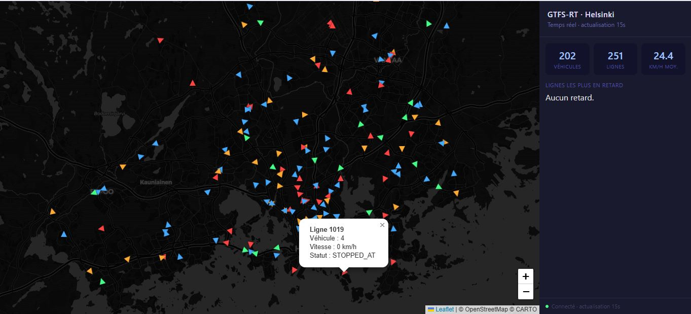
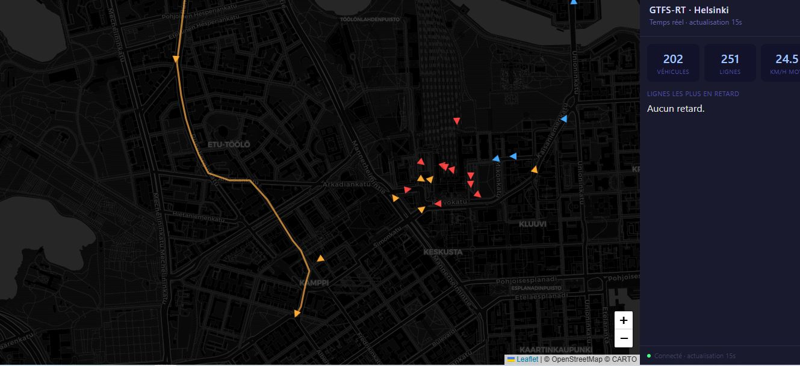
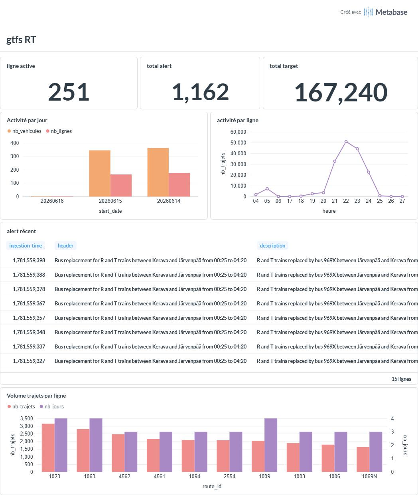
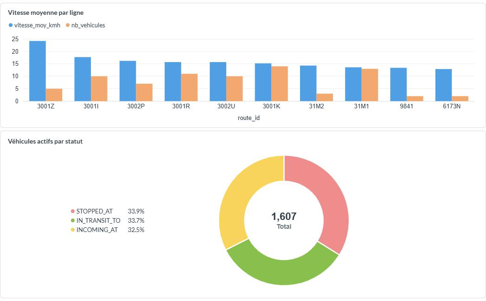

# GTFS-RT Pipeline

[](https://python.org)
[](https://docker.com)
[](https://kafka.apache.org)
[](https://cassandra.apache.org)
[](https://hsl.fi)
[](LICENSE)

> Pipeline temps-reel pour ingerer, transporter et stocker les donnees **GTFS-RT** (positions de vehicules, mises a jour de trajets et alertes service) de HSL Helsinki.

---

## Sommaire

- [Architecture](#architecture)
- [Captures d'ecran](#captures-decrit)
- [Prerequis](#prerequis)
- [Installation](#installation)
- [Acces aux services](#acces-aux-services)
- [Structure du projet](#structure-du-projet)
- [Configuration](#configuration)
- [Utilisation](#utilisation)
- [Commandes utiles](#commandes-utiles)
- [Data Flow](#data-flow)
- [Specifications techniques](#specifications-techniques)
- [Export du code](#export-du-code)

---

## Architecture

```
┌─────────────┐    ┌────────────────┐    ┌──────────────────┐    ┌──────────────┐
│             │    │                │    │                  │    │              │
│  HSL GTFS   │───▶│   GTFS-RT      │───▶│    Kafka         │───▶│   Cassandra  │
│  Realtime   │    │   Producer     │    │    (KRaft)       │    │   (4.1)      │
│  API        │    │                │    │                  │    │              │
└─────────────┘    └────────────────┘    ├──────────────────┤    └──────────────┘
                                          │                  │
                                          │   Kafka UI       │
                                          │   (localhost:8080)│
                                          └──────────────────┘
```

| Composant | Technologie | Role |
|---|---|---|
| **Source** | HSL GTFS-RT API | Donnees temps-reel des bus/tram/metro d'Helsinki |
| **Producer** | Python 3.11 + `gtfs-realtime-bindings` | Telecharge, parse et publie dans Kafka (polling 5s) |
| **Transport** | Kafka 7.6.1 (KRaft, sans Zookeeper) | File de messages avec 3 topics |
| **Consumer** | Python 3.11 + `cassandra-driver` | Lit Kafka et ecrit dans Cassandra (batch UNLOGGED) |
| **Stockage** | Cassandra 4.1 | Base NoSQL columnar |
| **UI Kafka** | Kafka UI | Monitoring visuel des topics et messages |

---

## Captures d'ecran

### Dashboard temps reel

Carte interactive avec les vehicules en temps reel (fleches orientees selon la direction, colorees par vitesse), statistiques globales et top retards.





### Metabase

Requetage SQL via Trino sur les donnees Cassandra : statistiques trajets, alertes service et top retards.





---

## Prerequis

- [Docker Desktop](https://www.docker.com/products/docker-desktop/) (v24+)
- [Docker Compose V2](https://docs.docker.com/compose/) (inclus avec Docker Desktop)
- Python 3.11+ *(optionnel, pour test local)*

```bash
docker --version       # Docker 24+
docker compose version # Docker Compose v2+
```

---

## Installation

```bash
# 1. Cloner le depot
git clone https://github.com/elhamrit-stack/GTFS_RT.git
cd GTFS_RT

# 2. Lancer toute la stack (Kafka + Cassandra + Producer + Consumer)
docker compose up -d

# 3. Verifier que tout tourne
docker compose ps

# 4. Suivre les logs
docker compose logs -f producer
docker compose logs -f consumer
```

---

## Acces aux services

| Service | URL | Description |
|---|---|---|
| **Dashboard** | [http://localhost:3001](http://localhost:3001) | Carte interactive temps reel + stats |
| **Metabase** | [http://localhost:3000](http://localhost:3000) | BI / dashboards SQL (driver Presto) |
| **Kafka UI** | [http://localhost:8080](http://localhost:8080) | Monitoring visuel des topics Kafka |
| **Trino** | [http://localhost:8081](http://localhost:8081) (API) | Moteur SQL distribue (catalogue `cassandra`) |
| **Cassandra** | `localhost:9042` (CQL) | Base NoSQL, interrogeable via `docker exec -it cassandra cqlsh` |

> **Note Metabase** : lors de l'ajout d'une base, choisis le driver **Presto**, renseigne `trino` comme hote, `8080` comme port, `cassandra` comme catalogue et `gtfs` comme schema.

---

## Structure du projet

```
GTFS_RT/
├── docker-compose.yml       ← Orchestration complete (6 services)
├── .env                     ← Configuration (variables d'environnement)
├── .gitignore
├── README.md
├── export_all.py            ← Script pour exporter tous les fichiers
├── all.txt                  ← Code source consolide (auto-genere)
│
├── producer/                ← Ingestion GTFS-RT → Kafka
│   ├── Dockerfile
│   ├── requirements.txt
│   ├── config.py            ← Configuration producer
│   ├── fetcher.py           ← Download & parsing GTFS-RT (3 endpoints)
│   ├── producer.py          ← Publication Kafka avec gestion d'erreurs
│   └── main.py              ← Boucle principale avec graceful shutdown
│
├── consumer/                ← Kafka → Cassandra
│   ├── Dockerfile
│   ├── requirements.txt
│   ├── config.py            ← Configuration consumer
│   ├── cassandra_client.py  ← Connexion Cassandra + batch UNLOGGED
│   ├── consumer.py          ← Lecture Kafka avec commit manuel
│   └── main.py              ← Point d'entree avec graceful shutdown
│
├── cassandra/
│   └── init.cql             ← Schema : keyspace + 3 tables
│
└── docs/
    └── topics.md            ← Contrat de donnees
```

---

## Configuration

Le fichier `.env` contient tous les parametres :

| Variable | Description | Defaut |
|---|---|---|
| `KAFKA_BOOTSTRAP_SERVERS` | Adresse du broker Kafka | `kafka:29092` |
| `TOPIC_VEHICLE_POSITIONS` | Topic positions vehicules | `gtfs.vehicle_positions` |
| `TOPIC_TRIP_UPDATES` | Topic mises a jour trajets | `gtfs.trip_updates` |
| `TOPIC_SERVICE_ALERTS` | Topic alertes service | `gtfs.service_alerts` |
| `GTFS_VEHICLE_URL` | Endpoint HSL vehicle positions | *endpoint HSL* |
| `GTFS_TRIP_URL` | Endpoint HSL trip updates | *endpoint HSL* |
| `GTFS_ALERTS_URL` | Endpoint HSL service alerts | *endpoint HSL* |
| `POLL_INTERVAL_SECONDS` | Intervalle de rafraichissement | `5` |
| `CASSANDRA_HOST` | Hote Cassandra | `cassandra` |
| `CASSANDRA_PORT` | Port Cassandra | `9042` |
| `CASSANDRA_KEYSPACE` | Keyspace Cassandra | `gtfs` |

---

## Utilisation

### 1. Lancer le projet

```bash
# Lancer tout le projet (premier plan - voir les logs en direct)
docker compose up

# Lancer + rebuild (quand tu modifies le code)
docker compose up --build
```

### 2. Verifier les conteneurs

```bash
docker ps
```

Vous devez voir : `producer`, `consumer`, `kafka`, `kafka-ui`, `cassandra`, `cassandra-init` (puis `kafka-init`).

### 3. Logs

```bash
# Producer (fetch GTFS-RT -> publish Kafka)
docker logs -f gtfs-producer

# Consumer (consume Kafka -> insert Cassandra)
docker logs -f gtfs-consumer

# Logs Cassandra
docker logs -f cassandra
```

### 4. Tester Kafka

```bash
# Voir les topics
docker exec -it kafka kafka-topics --bootstrap-server kafka:29092 --list

# Lire les messages (test consumer)
docker exec -it kafka kafka-console-consumer \
  --bootstrap-server kafka:29092 \
  --topic gtfs.vehicle_positions \
  --from-beginning
```

### 5. Interroger Cassandra (CQLSH)

```bash
# Entrer dans Cassandra
docker exec -it cassandra cqlsh

-- Choisir la base
USE gtfs;

-- Voir les tables
DESCRIBE TABLES;

-- Requete principale
SELECT * FROM vehicle_positions LIMIT 10;

-- Verifier si donnees existent
SELECT COUNT(*) FROM vehicle_positions;
```

---

## Commandes utiles

```bash
# ─── Docker (lancer / arreter) ───────────────────────────

# Lancer tout le projet
docker compose up

# Lancer + rebuild (quand tu modifies le code)
docker compose up --build

# Arreter tout
docker compose down

# Stop rapide (sans supprimer les conteneurs)
docker compose stop

# Redemarrer
docker compose restart

# ─── Verifier les conteneurs ─────────────────────────────

docker ps

# ─── Logs ─────────────────────────────────────────────────

# Producer
docker logs -f gtfs-producer

# Consumer
docker logs -f gtfs-consumer

# Cassandra
docker logs -f cassandra

# ─── Kafka ────────────────────────────────────────────────

# Voir les topics
docker exec -it kafka kafka-topics --bootstrap-server kafka:29092 --list

# Lire les messages (test consumer)
docker exec -it kafka kafka-console-consumer \
  --bootstrap-server kafka:29092 \
  --topic gtfs.vehicle_positions \
  --from-beginning

# Voir les offsets du groupe
docker exec kafka kafka-consumer-groups --bootstrap-server kafka:29092 --group gtfs-cassandra-consumer --describe

# ─── Cassandra ────────────────────────────────────────────

# Entrer dans Cassandra
docker exec -it cassandra cqlsh

# Choisir la base
USE gtfs;

# Voir les tables
DESCRIBE TABLES;

# Requete principale
SELECT * FROM vehicle_positions LIMIT 10;

# Verifier si donnees existent
SELECT COUNT(*) FROM vehicle_positions;

# Decrire le keyspace
docker exec -it cassandra cqlsh -e "DESCRIBE KEYSPACE gtfs;"

# ─── Rebuild ──────────────────────────────────────────────

# Rebuild un service sans cache
docker compose build --no-cache producer
docker compose build --no-cache consumer

# Rebuild et relancer
docker compose up --build

# ─── Maintenance ──────────────────────────────────────────

# Nettoyer les donnees Cassandra (tout supprimer)
docker compose down -v && docker compose up --build

# Reinitialiser les offsets Kafka
docker exec kafka kafka-consumer-groups --bootstrap-server kafka:29092 \
  --group gtfs-cassandra-consumer \
  --reset-offsets --to-latest --execute --all-topics
```

---

## Requetes Trino validees pour Metabase

Connecte-toi a Metabase (`http://localhost:3000`) avec le driver **Presto**, hote `trino`, port `8080`, catalogue `cassandra`, schema `gtfs`.

### 1 — Retard moyen global

```sql
SELECT
    ROUND(CAST(AVG(avg_delay_seconds) AS double) / 60.0, 2) AS retard_moyen_min
FROM trip_updates
```

### 2 — Stats globales (trajets + lignes)

```sql
SELECT
    COUNT(*) AS total_trajets,
    COUNT(DISTINCT route_id) AS lignes_actives
FROM trip_updates
```

### 3 — Top 10 retards par ligne

```sql
SELECT
    route_id,
    ROUND(CAST(AVG(avg_delay_seconds) AS double) / 60.0, 1) AS retard_min,
    COUNT(*) AS nb_trajets
FROM trip_updates
WHERE avg_delay_seconds > 0
GROUP BY route_id
HAVING COUNT(*) > 3
ORDER BY retard_min DESC
LIMIT 10
```

### 4 — Alertes recentes

```sql
SELECT
    ingestion_time,
    header,
    description
FROM service_alerts
ORDER BY ingestion_time DESC
LIMIT 20
```

### 5 — Nombre total d'alertes

```sql
SELECT COUNT(*) AS total_alerts FROM service_alerts
```

---

## Data Flow

```
HSL API                     Kafka Topics                  Cassandra
─────────                   ─────────────                 ─────────
                            ┌──────────────────┐
vehicle-positions ────────▶ │ gtfs.vehicle_    │ ──────▶ vehicle_positions
                            │ positions        │         (route_id, date,
                            └──────────────────┘          ingestion_time DESC)
                            ┌──────────────────┐
trip-updates ─────────────▶ │ gtfs.trip_       │ ──────▶ trip_updates
                            │ updates          │         (route_id, date,
                            └──────────────────┘          ingestion_time DESC)
                            ┌──────────────────┐
service-alerts ───────────▶ │ gtfs.service_    │ ──────▶ service_alerts
                            │ alerts           │         (ingestion_time)
                            └──────────────────┘
```

### Topics Kafka

| Topic | Cle | Format | Description |
|---|---|---|---|
| `gtfs.vehicle_positions` | `full_vehicle_id` | JSON | Positions GPS des vehicules |
| `gtfs.trip_updates` | `route_id` | JSON | Retards et mises a jour de trajets |
| `gtfs.service_alerts` | *aucune* | JSON | Alertes service (travaux, perturbations) |

### Tables Cassandra

| Table | Partition Key | Clustering | Description |
|---|---|---|---|
| `vehicle_positions` | `(route_id, start_date)` | `ingestion_time DESC, vehicle_id` | Positions GPS avec operateur et statut lisible |
| `trip_updates` | `(route_id, start_date)` | `ingestion_time DESC` | Retards moyens par trajet |
| `service_alerts` | `ingestion_time` | - | Alertes texte avec periode de validite |

---

## Specifications techniques

### Points cles implementes

| Aspect | Implementation |
|---|---|
| **Vehicle ID** | `operator_id` + `vehicle_id` extraits du format HSL `<op>/<id>` |
| **Statut vehicule** | Stocke en texte lisible (`IN_TRANSIT_TO`, `STOPPED_AT`...) au lieu de l'enum entier |
| **Incertitude** | Champ `max_uncertainty` dans les trip updates (qualite donnee) |
| **Polling** | 5 secondes (evite rate limiting HSL) |
| **Batching Cassandra** | `BatchType.UNLOGGED` par lots de 50, buffer max 500 |
| **Commit Kafka** | Manuel (`enable_auto_commit=False`) apres chaque message |
| **Backpressure** | Flush force si le buffer depasse `MAX_BUFFER` |
| **Graceful shutdown** | Handlers `SIGTERM`/`SIGINT` + flush final + close producer/consumer |
| **Topics** | 3 topics distincts : positions, mises a jour, alertes |

### Ameliorations possibles

- Ajout de Trino pour le requetage SQL interome
- Metabase ou Apache Superset pour les dashboards
- Alerting sur les retards anormaux
- Compression avancee Kafka (ZSTD)
- Replication Cassandra multi-DC

---

## Export du code

Un script permet de concatener tous les fichiers du projet dans un seul fichier `all.txt` :

```bash
python export_all.py
# Genere all.txt avec tous les fichiers listes et leurs contenus
```

Chaque section est delimitee par `FICHIER : chemin/relatif`.

---

## Licence

Ce projet est sous licence **MIT**. Voir le fichier [LICENSE](LICENSE) pour plus de details.

---

<p align="center">
  <sub>Construit dans le cadre du module Big Data — ETGI/S8</sub>
</p>
